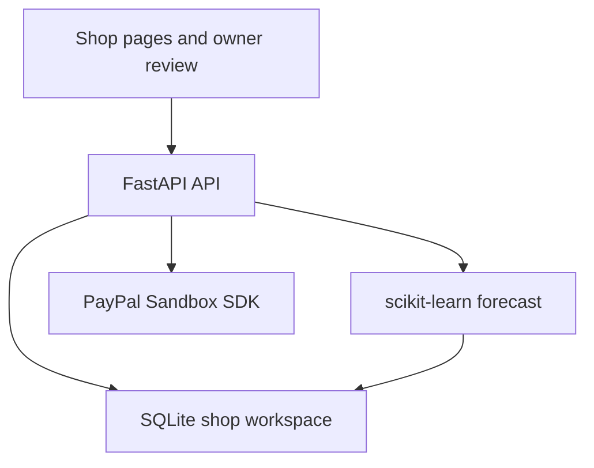
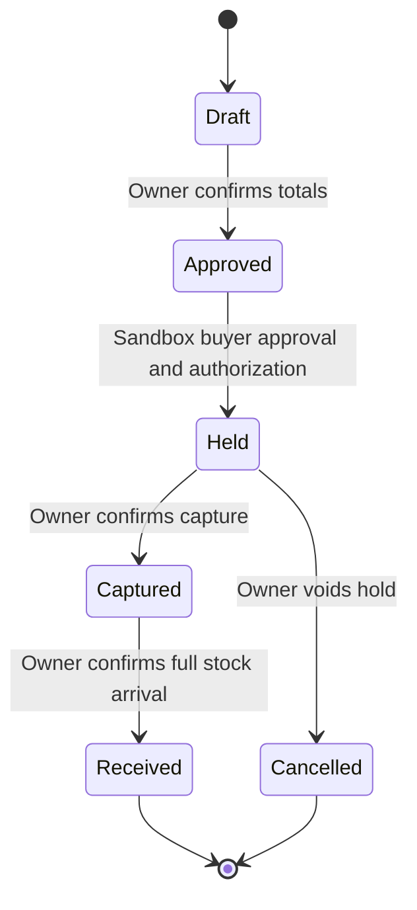

# Architecture and model details

## Runtime structure

A single FastAPI application serves the HTML/CSS/JavaScript pages and JSON APIs. SQLite stores inventory, sales, history, quotes, forecasts, reviews, orders, payment actions and stock receipts. A request-scoped workspace selects the existing-shop or demo-shop database.

The existing shop uses `resupply.db`; `/demo/` uses `resupply-demo.db`. The demo's durable namespace also separates PayPal invoice/reference IDs. A delayed browser callback remains attached to its originating workspace.

## Source map

| File | Responsibility |
| --- | --- |
| `backend/main.py` | App routes, inventory, sales, quotes, restock/budget rules, order snapshots, approval, payments and receipt transactions. |
| `backend/index.html`, `app_ui.css`, `app_ui.js` | UI structure, styling, navigation and dashboard behavior. |
| `backend/sales_history.py` | Confirmed daily totals, source/stockout flags and CSV preview/import. |
| `backend/demand_forecast.py` | Data readiness, model fitting, chronological tests and saved reports. |
| `backend/forecast_purchasing.py` | Explicit forecast review and date-wise purchasing projections. |
| `backend/paypal_gateway.py`, `payment_checks.py` | Official SDK adapter and verification of remote amounts/status/identities. |
| `backend/shop_workspace.py`, `demo_shop.py` | Request scope, separate databases and repeatable synthetic demo preparation. |
| `backend/voice_assistant.py` | Defined read-only intents for stock, forecasts and budgets. |
| Corresponding `*_ui.js` modules | Page-specific rendering, request IDs, reviews and recovery controls. |
| `tests/` | Temporary-database integration checks and JavaScript UI checks. |

## Forecast specification

- One `RandomForestRegressor` per product. Configuration: 80 trees, maximum depth 7, minimum leaf size 2, random seed 42.
- Features: lag 1, lag 7, mean 7, mean 14 and seven weekday indicators.
- Data: up to 365 days; at least 56 consecutive confirmed same-source dates without stockout flags. The usable series must end within seven days of the shop date.
- Confirmed zero-sales days are valid observations. Missing days are unknown and break the training run. Stockout days cannot establish unconstrained demand.
- One to three expanding chronological backtests train on earlier dates and forecast seven later dates recursively. Intermediate and target test labels are not used as prediction features.
- Compare MAE with a seven-day mean baseline. Select RF only when baseline MAE is positive and RF MAE is at most `0.95 × baseline MAE`. A zero-error baseline remains selected.
- Refit on the available eligible series after comparison and save a report for the next seven days.
- The report is bound to its source, history fingerprint, shop date and algorithm version. Changed history/date makes it stale for new purchasing until training and explicit review.
- Longer planning projections, up to 74 days, are produced recursively; only the seven-day horizon is historically tested.

Reports preserve candidate metrics even if the mean wins. Synthetic results are labeled Demo and describe that dataset only.

## From forecast to purchase quantities

Preview uses today's remaining demand, future daily estimates, stock, selected supplier delivery times, coverage and buffer. It considers approved, captured, unreceived incoming orders only when the owner supplied an eligible arrival date. Incoming units are applied at the end of that date; unknown/overdue dates are excluded.

The projected peak deficit is rounded up once to whole units. Today's already-recorded sales are subtracted from today's remaining estimate. Purchases use a reviewed current forecast or the labeled average fallback.

The average fallback can use eligible actual complete totals. A legacy live-sales/calendar average remains available when no complete totals exist; this fallback does not provide the same training-data guarantees as the ML series.

The budget allocator follows urgency, with a stable product-ID tie break. It buys up to the suggested quantity at the selected unit price while money remains. It may allocate a partial quantity; it is not a global optimization solver. Money uses Decimal and integer cents.

## Order and payment lifecycle

Approval freezes quantities, prices, supplier details, planning basis, shipping, tax and the spending limit. Payment verification checks the remote amount/currency and order identity before allowing a lifecycle transition.

Durable action IDs and local action fences support recovery from uncertain network results. Remote status can be reconciled before retrying; this is not a promise that every unresolved payment can be retried without review.

Full receiving requires the verified captured order. The receipt and stock additions commit together in SQLite; a unique order receipt prevents adding it twice. Supplier delivery is simulated/manual. No external supplier event triggers a charge or receipt.

## Voice behavior

Browser speech recognition transcribes into an editable field. Typed input works without microphone support. The backend parses supported intents and reads shop state or previews a budget. Voice cannot approve orders, pay, record sales or receive stock. This is not an LLM conversational agent.

## Scope

Single local owner, USD, one Sandbox merchant, manual supplier selection, full receiving. No production payment integration, authentication, split payouts, refunds or partial receipts. Actual-shop demand quality and business impact require a real pilot.
